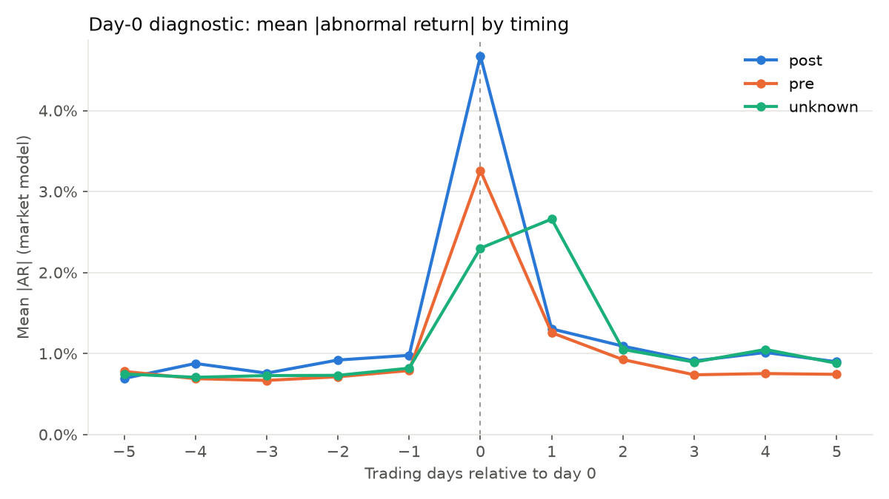
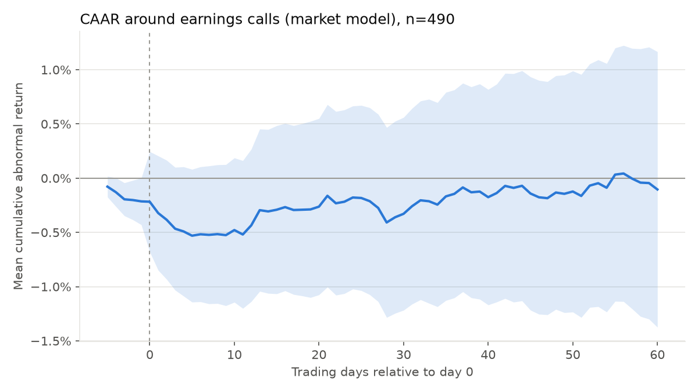

# event_study — abnormal returns and volatility around earnings calls

Turns the daily prices from `../acl19_proc` into per-call targets for the multimodal
model: cumulative abnormal returns (CARs) for **direction**, and log volatility for
**volatility**. It also checks that the event timing is right and summarises the
average reaction to a call.

The design and its decisions are in `docs/plans/2026-10-06-event-study-design.md`.

## Current state

| | |
|---|---|
| Calls in the dataset | 572 |
| Events with all fields (`ok`) | 490 |
| Calls without prices (`no_price`) | 82, from the 40 delisted companies |
| Tests | 62, all passing |

## Requirements

Python 3.13 or newer, and [uv](https://docs.astral.sh/uv/). It needs the price files and
`SPY.csv` from `../acl19_proc`. Generate those with
`uv run python fetch_prices.py --market SPY` there.

## Usage

Run from this directory:

```sh
uv sync

# dataset + prices → data/events.csv, data/ar_daily.csv (a few seconds)
uv run python build_events.py

# events → data/figures/summary.md and PNG figures
uv run python analyse.py

uv run pytest
```

`build_events.py` takes `--dataset` (default `~/var/data/earnings_calls/ACL19_Release`),
`--company-csv`, `--prices-dir`, `--market` (default `SPY`) and `--out-dir`. It exits
with 1 if a dataset folder has no row in `company.csv`. `analyse.py` takes `--in-dir`
and `--out-dir`.

## Method

| Step | Choice |
|---|---|
| Returns | Daily simple returns on `Adj Close`, with the stock aligned to SPY's trading calendar |
| Day 0 | `pre` / `unknown`: first trading day on or after the call date. `post`: first trading day after it |
| Timing | From the transcript: "good morning" → `pre`, "good afternoon/evening" → `post`. Without a greeting, "this morning" / "this afternoon/evening" decide. Otherwise `unknown` |
| Normal returns | Market model `R_i = α + β·R_SPY`, fitted by OLS on relative days [−150, −30]. Needs at least 100 returns |
| Abnormal returns | `ar_mm` (market model) and `ar_ma = R_i − R_SPY`, for days [−5, +60] |
| CARs | [−5,−1], [0,+1], [0,+5], [0,+20] and [0,+60]. NaN if any day is missing |
| Volatility | Qin & Yang (2019), equation (1): ln of the sample std of the n + 1 returns on days [0, n], for n = 3, 7, 15, 30. `vol_pre_n` is the same over [−n−1, −1] |

For `unknown` calls the price reaction falls on day 0 or day +1, so use the [0,+1] CAR,
not day 0 alone, as the short-window target.

## Files

| Path | Description |
|---|---|
| `events_input.py` | Scans the dataset folders and classifies call timing |
| `returns.py` | Pure functions: day 0, market model, abnormal returns, CARs, volatility |
| `build_events.py` | Builds `events.csv` and `ar_daily.csv` |
| `analyse.py` | Day-0 diagnostic, CAAR and volatility tables, figures |
| `tests/` | pytest suite with synthetic data. No network access and no real data needed |
| `data/events.csv` | Generated: one row per call |
| `data/ar_daily.csv` | Generated: daily abnormal returns, `event_id, rel_day, ar_mm, ar_ma` |
| `data/figures/` | Generated: `summary.md` and PNG figures |

### `data/events.csv`

One row per dataset folder, including calls without prices. `event_id` is the folder
name, e.g. `3M Company_20170425`, and is the join key for text and audio embeddings.

| Columns | Description |
|---|---|
| `event_id, company, ticker, call_date, timing, day0_date, status` | Identity and timing. `ticker` is the current Yahoo ticker |
| `alpha, beta, sigma, est_n` | Market-model fit. `sigma` is the residual std |
| `car_mm_*`, `car_ma_*` | CARs per window: `m5_m1`, `0_1`, `0_5`, `0_20`, `0_60` |
| `vol_3 … vol_30`, `vol_pre_3 … vol_pre_30` | Post-call and pre-call log volatility |

| Status | Meaning |
|---|---|
| `ok` | All fields computed |
| `no_price` | The company is `no_data` in `company.csv` |
| `unmatched` | The folder name isn't in `company.csv` |
| `no_day0` | The call date is beyond the price data |
| `short_estimation` | Fewer than 100 estimation returns. Market-adjusted fields only |

A direction label is `sign(car_…)`. A volatility model should be compared with
`vol_pre_n`, the "past volatility" baseline from Qin & Yang.

## Results

From `data/figures/summary.md`, 490 events.

**Timing is right.** Mean |AR| peaks on day 0 for `pre` (3.3%) and `post` (4.7%)
calls, against about 0.8% on other days. For `unknown` calls it is split between day 0
(2.3%) and day +1 (2.7%). The largest day-0 moves match the news: AMD −24.8% on
2017-05-02 after an after-close call, and Kroger −18.7% on 2017-06-15 after a
pre-market guidance cut.



**On average, calls have no abnormal return in any direction.** No CAAR from [0,+1] to
[0,+60] differs from zero (all p > 0.17, raw and winsorized, both models). Good and
bad news cancel out across calls. Any directional signal has to come from what is said
and how it is said, which is the question for the model.

| Window | Mean CAR (MM) | t | Winsorized mean | t | % positive |
|---|---|---|---|---|---|
| [−5,−1] | −0.21% | −1.94 | −0.22% | −2.08 | 48.4 |
| [0,+1] | −0.11% | −0.44 | −0.09% | −0.40 | 52.0 |
| [0,+5] | −0.32% | −1.10 | −0.34% | −1.37 | 48.4 |
| [0,+20] | −0.05% | −0.12 | −0.25% | −0.76 | 51.2 |
| [0,+60] | +0.11% | 0.18 | −0.17% | −0.31 | 47.8 |



**Volatility rises after a call and decays.** Post-call log volatility is higher than
pre-call at every horizon. The gap is 0.80 log points at 3 days (t = 21.0) and 0.24 at
30 days (t = 14.9).

| n | `vol_n` | `vol_pre_n` | Difference | t |
|---|---|---|---|---|
| 3 | −4.04 | −4.84 | 0.80 | 21.0 |
| 7 | −4.20 | −4.73 | 0.54 | 19.5 |
| 15 | −4.31 | −4.68 | 0.37 | 17.4 |
| 30 | −4.39 | −4.63 | 0.24 | 14.9 |

**Long-window CARs have fat tails.** [0,+60] CARs range from −41% to +129%. Nektar's two
calls (+69% and +129%) account for about half of the `unknown` group's +2.7% mean drift
in `caar_by_timing_mm.png`. Use the winsorized figures, or robust methods, for
cross-sectional tests.

## Caveats for the writeup

- **Event clustering.** Calls bunch in earnings season, so returns are correlated across
  events and the t-statistics are overstated. The [−5,−1] pre-drift (p = 0.04
  winsorized) is borderline and likely not significant once this is accounted for.
- **Repeat firms.** 490 events come from 240 companies, so observations are not
  independent.
- **Release and call are bundled.** The press release usually comes out hours before the
  call. The day-0 return reflects both the numbers and the call's tone.
- **Timing is inferred.** It comes from greetings, not timestamps. 151 events with
  prices are `unknown`, which the [0,+1] window handles.
- **Volatility horizons are trading days.** Qin & Yang describe n as calendar days, but
  their formula sums daily returns. This is noted in `returns.log_vol`.
- **Survivorship.** The 82 calls from delisted companies have no prices and are excluded.
