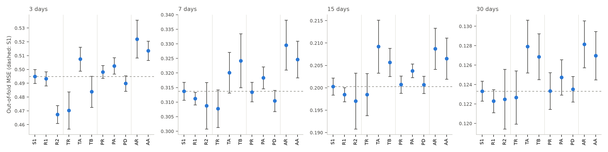
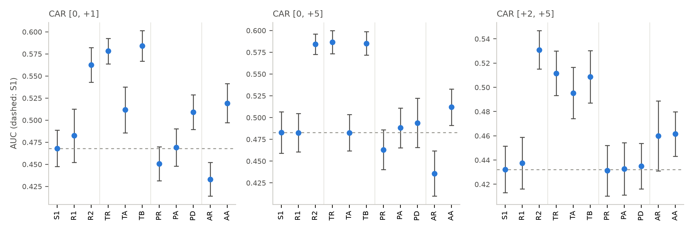

# Round 3: Prepared Remarks versus Answers

Draft section for the paper. Every number below is from `results/round3/` (commit
1d883f4) and the files it cites. [Note: section numbers, and where this sits relative to
§6–§7, are for the final edit; it could be §6.9 or a new §7 before the Discussion.]

## Motivation

Rounds 1–2 averaged each call into one vector, so the executive's prepared remarks and
their answers to analysts' questions were pooled. The two differ in kind: the remarks
are scripted and largely restate the earnings release issued shortly before the call,
while the answers are unscripted responses to questions. Prior work finds the Q&A more
informative for markets than the presentation (Price et al., 2012) [Note: add Matsumoto,
Pronk and Roelofsen (2011) once verified], and Todd et al. (2025) find that audio
improves sentiment classification mainly on Q&A sentences. If the calls carry
information about volatility beyond past volatility, the answers are where we would
expect it, in both text and voice.

## Data: separating remarks from answers

The release keeps one speaker per call, the "most spoken executive" (usually the CEO,
sometimes the CFO or head of investor relations), and includes both their prepared
remarks and their answers in the Q&A; analysts' questions and other speakers are absent.
Each clip's file name carries a paragraph number, one paragraph per uninterrupted turn,
which the earlier stages discarded. We label each sentence as `remarks`, `answers`,
`closing` (scripted remarks after the Q&A) or `heading` (a transcript heading such as
"Question-and-Answer Session", which has its own clip) with three rules applied in
order: the remarks end at a handover to questions in the first two paragraphs ("we'd be
happy to take your questions", or the heading) if there is one (52 of the 488 calls); at
the end of paragraph 2 if paragraph 1 hands off to a named colleague and paragraph 2
opens by thanking them, a second scripted segment (11 calls); and otherwise at the end
of paragraph 1 (425 calls). A hand audit of 50 calls drawn at random from the 488 found
the remarks/answers boundary correct in all 50 (95% Wilson interval 0.93–1.00) and the
answers/closing boundary in 49 (0.90–1.00); the one error left the end of the last
answer in the closing remarks.

The 488 calls hold 34,664 sentences of remarks and 43,364 of answers (medians 66 and 76
per call). Round 3 uses the **457 calls from 232 firms** with at least 10 usable audio
sentences in each section. A few answers contain analysts' words that the dataset
attributed to the executive.

## Design

The design was committed before any section feature was computed or any model run
(commit 2afdd80, 13 October 2026), in the same form as round 2 (Appendix A.1). For each
call and section it builds round 1's blocks from that section's sentences: the
FinBERT-tone mean vector and six sentiment summaries (all sentences), the four prosody
features and the HuBERT mean of all 13 hidden states (usable clips only), and the
change in prosody from remarks to answers. As a check that these are round 1's features
split rather than new ones, every call's sentence-weighted recombination of its section
features reproduces the committed call-level features (text, HuBERT and Praat), and the
rerun's FinBERT probabilities match the committed ones sentence by sentence.

Every model extends a baseline **S1**: past volatility, recording format and the log
number of sentences in each section, so no content block is credited with section
length. The four confirmatory hypotheses, tested at each volatility horizon with the
firm-clustered bootstrap and Holm correction across horizons, as in rounds 1–2:

- **H6** answers' text helps (TA vs S1);
- **H7** answers' text beats remarks' text (TA vs TR);
- **H8** answers' prosody beats remarks' prosody (PA vs PR);
- **H9** the prosody shift under questioning helps (PD vs S1).

Evaluation is round 1's (5 folds × 10 repeats grouped by firm, inner grouped tuning,
ridge or logistic regression) on new splits of the 457 calls. A registered timing trial,
which kept no predictions, projected 2.95 hours, under the 8-hour limit, so every rung
used 10 repeats. There were no deviations from the design.

## Results

**Table R1.** Out-of-fold MSE (mean ± SD over 10 repeats), 457 calls.

| Model | vol₃ | vol₇ | vol₁₅ | vol₃₀ |
|---|---|---|---|---|
| S1: past + format + size | 0.495 ±0.005 | 0.314 ±0.003 | 0.200 ±0.002 | 0.123 ±0.001 |
| R1: past + format (round 1) | 0.493 ±0.005 | 0.311 ±0.002 | 0.198 ±0.002 | 0.122 ±0.001 |
| R2: R1 + call text (round 1) | 0.467 ±0.007 | 0.309 ±0.008 | 0.197 ±0.006 | 0.122 ±0.003 |
| TR: S1 + remarks text | 0.470 ±0.013 | 0.308 ±0.006 | 0.198 ±0.005 | 0.123 ±0.003 |
| TA: S1 + answers text | 0.507 ±0.009 | 0.320 ±0.007 | 0.209 ±0.006 | 0.128 ±0.003 |
| TB: S1 + both | 0.484 ±0.011 | 0.324 ±0.009 | 0.206 ±0.003 | 0.127 ±0.002 |
| PR: S1 + remarks prosody | 0.498 ±0.005 | 0.313 ±0.003 | 0.201 ±0.002 | 0.123 ±0.002 |
| PA: S1 + answers prosody | 0.503 ±0.006 | 0.318 ±0.004 | 0.204 ±0.002 | 0.125 ±0.002 |
| PD: S1 + prosody shift | 0.490 ±0.006 | 0.310 ±0.004 | 0.201 ±0.002 | 0.124 ±0.001 |
| AR: S1 + remarks HuBERT | 0.522 ±0.014 | 0.330 ±0.009 | 0.209 ±0.005 | 0.128 ±0.002 |
| AA: S1 + answers HuBERT | 0.514 ±0.007 | 0.325 ±0.006 | 0.207 ±0.005 | 0.127 ±0.002 |

**Table R2.** Pre-registered hypotheses: mean per-call MSE difference (positive = the
hypothesised model is better) with its 95% firm-clustered bootstrap interval, and the
smallest Holm-adjusted one-sided p across the four horizons.

| Hypothesis | vol₃ | vol₇ | vol₁₅ | vol₃₀ | min p_Holm |
|---|---|---|---|---|---|
| H6: answers' text helps | −0.013 [−0.039, +0.014] | −0.006 [−0.021, +0.008] | −0.009 [−0.020, +0.001] | −0.005 [−0.011, +0.001] | 1.00 |
| H7: answers beat remarks (text) | −0.037 [−0.069, −0.007] | −0.012 [−0.032, +0.006] | −0.011 [−0.023, +0.000] | −0.005 [−0.011, +0.000] | 1.00 |
| H8: answers beat remarks (prosody) | −0.004 [−0.014, +0.005] | −0.005 [−0.014, +0.005] | −0.003 [−0.008, +0.002] | −0.001 [−0.005, +0.002] | 1.00 |
| H9: prosody shift helps | +0.005 [−0.006, +0.017] | +0.003 [−0.005, +0.012] | −0.000 [−0.005, +0.004] | −0.000 [−0.003, +0.003] | 0.76 |

**None of the four hypotheses is supported at any horizon.** H8 and H9 fail, as the
design anticipated. H6 fails outright: adding the answers' text raises three-day MSE
from 0.495 to 0.507, and the answers never improve on S1. H7 fails in the opposite
direction: at three days the remarks' text beats the answers' text by 0.037, and the
interval excludes zero. Because the registered test was one-sided in the other
direction, this reversal is exploratory.

**Exploratory comparisons** support the reversal and place the signal. It is not an
artefact of section length: with both sections cut to the same number of sentences,
answers still lose to remarks by 0.037 at three days (interval −0.067 to −0.006). It is
not specific to FinBERT-tone: with ProsusAI FinBERT the difference has the same sign
(−0.023, interval −0.054 to +0.009). The remarks carry round 1's text effect: TR improves
on S1 by 5.0% at three days (+0.025, p = 0.096), matching round 1's 6% (p = 0.084) and
R2's 5.3% gain over R1 on these 457 calls; adding the remarks to the answers helps
(TB vs TA, +0.024, p = 0.013). Splitting does not help, though: TB, with the two sections
as separate blocks, is worse than R2's single call vector at every horizon (e.g. −0.017,
interval −0.028 to −0.005, at three days). Audio repeats rounds 1–2: the section HuBERT
vectors (AR, AA) are significantly worse than S1 at every horizon, and the answers'
prosody (PA) at 3, 7 and 15 days.

**Table R3.** Direction of the abnormal return (exploratory): AUC by CAR window.
Direction models omit past volatility.

| Model | [0, +1] | [0, +5] | [+2, +5] |
|---|---|---|---|
| S1 | 0.468 | 0.483 | 0.432 |
| R2: call text | 0.563 | 0.584 | 0.531 |
| TR: remarks text | 0.578 | 0.587 | 0.512 |
| TA: answers text | 0.512 | 0.483 | 0.495 |
| TB: both | 0.584 | 0.585 | 0.509 |
| PD: prosody shift | 0.509 | 0.494 | 0.435 |
| AA: answers HuBERT | 0.519 | 0.512 | 0.462 |

The direction results have the same shape. The remarks' text carries the directional
signal for the windows that start on day 0 (AUC 0.578 and 0.587, against 0.512 and 0.483
for the answers; log-loss gain over S1 p = 0.057 and 0.056, uncorrected), and nothing
is clearly above chance in the post-reaction window [+2, +5], which excludes the press
release's first impact for every timing class. As in round 1, models with no
directional information score below 0.5 here (S1: 0.432 for [+2, +5]), because the
training-fold base rates are slightly anti-correlated with the test folds.

**Figure R1.** Out-of-fold MSE by model and horizon (mean ± SD over 10 repeats; lower is
better). Dashed: S1. Vertical lines separate the baselines, text, prosody and audio
rungs.

**Figure R2.** Direction AUC by model and CAR window. Dashed: S1.

## Interpretation

The only content signal in the calls sits in the executive's prepared remarks, and its
pattern points to the earnings news rather than to anything the call adds. The remarks
help where the target includes the reaction to the press release (three-day volatility;
direction from day 0) and fade once that reaction is excluded (longer volatility
horizons; direction over [+2, +5]). Prepared remarks restate the reported numbers and
guidance, so a text model reading them partly reads the earnings surprise. The answers,
the part of the call that exists only in the call, show no signal for volatility or
direction, in text or in voice, and the voice changes under questioning (H9) add
nothing.

This sharpens rounds 1–2. The weak three-day text effect of round 1 is the remarks', and
it is most plausibly the release restated. Without a control for the earnings surprise
we cannot separate the two, and with 457 calls the answers' null is not evidence of
absence: the answers' text interval excludes gains larger than about 3% of three-day MSE
(upper bound +0.014 against an S1 MSE of 0.495), and the answers' prosody interval
excludes any gain at three days (PA vs S1: −0.008, interval −0.014 to −0.002).

## Limitations specific to round 3

- One speaker: other executives' remarks and answers are absent, and so are the
  analysts' questions that give the answers their meaning.
- The split rules were audited on 50 random calls, which contained 5 `handover` calls
  and no `handback` calls; those rules are less tested.
- A few answers contain analysts' words assigned to the executive, adding noise to the
  answers' text.
- No earnings-surprise control; the post-reaction direction window is a partial
  substitute only.
- The reversal of H7 was not pre-registered; it should be confirmed on new data.

## Pre-registration timeline (round 3)

All times local (UTC+11), from the repository's commits and each run's metadata.

| When (2026) | Event | Evidence |
|---|---|---|
| 13 Oct, 19:43 | Split and hand audit committed | commit f590d63 |
| 13 Oct, 21:23 | Round-3 design committed (H6–H9, sample, runtime rule) | commit 2afdd80 |
| 15 Oct, 22:32–16 Oct, 00:40 | Section features built (FinBERT ×2, HuBERT) | features' meta.json |
| 16 Oct, 00:58 | Features, checks and runner committed | commit 5fac519 |
| 16 Oct, ~00:58–01:33 | Timing trial: timings only, no predictions kept | results/round3_trial/timing.json |
| 16 Oct, 07:36 | Runtime decision recorded in the design | commit 80b5673 |
| 16 Oct, ~21:55–17 Oct, 00:56 | Full run (3.0 h) | results/round3/run.json |
| 17 Oct, 09:41 | Results committed | commit 1d883f4 |
